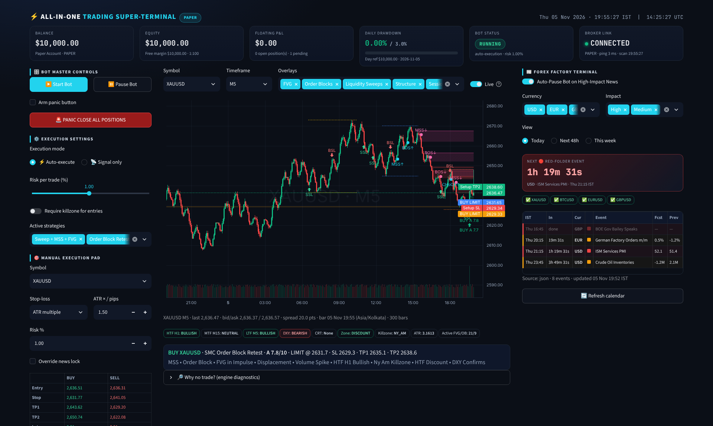

# All-in-One Forex & Crypto Algorithmic Trading Super-Terminal

Institutional SMC / ICT trading bot + dark-mode command dashboard for **XAUUSD, BTCUSD, EURUSD,
GBPUSD** (any MT5 symbol): MetaTrader 5 execution, Forex Factory news kill-switch and a
Telegram VIP-channel broadcaster — in one Python app.


<sub>Screenshot rendered with synthetic demo data.</sub>

---

## What it does

| Module | Responsibility |
| --- | --- |
| `quant_strategy_engine.py` | Fractal swings (no look-ahead), BSL/SSL liquidity sweeps, BOS / CHoCH / MSS on **body close**, Fair Value Gaps, Order Blocks, CRT + Turtle-Body-Soup, DST-aware killzones / Silver Bullet windows, H1/M15 bias + M5 trigger, EMA trend, relative volume, DXY inverse filter, IST time-candle breakout, weighted confluence score (A+/A/B/C) and dynamic lot sizing. |
| `mt5_execution_engine.py` | `MT5Broker` (reconnect with back-off, symbol suffix/alias resolution, broker-clock → UTC, spread filter, stop-level checks, `order_check` pre-flight, filling-mode fallback, requote retries, partial closes, deal-history P&L) and `PaperBroker` (simulated fills on public Binance/Yahoo data). Also the **PositionProtector** (TP1 partial, auto-breakeven at 1R, ATR/points/structure trailing after 1.5R) and the **DailyDrawdownGuard** circuit breaker. |
| `forex_factory_engine.py` | Weekly calendar from the faireconomy JSON feed → XML feed → forexfactory.com HTML → disk cache, rate-limit back-off, IST conversion, countdowns and `is_news_blackout_active(symbol)`. |
| `telegram_broadcaster.py` | Async dispatcher thread with per-chat rate limits, `retry_after` handling, HTML fallback. Signal cards, TP1/BE/trailing/close updates (threaded as replies to the signal), morning red-folder digest, 15-minute pre-news warning, emergency alerts. |
| `background_worker.py` | Scanner, protector, news and supervisor threads; signal gating; single-instance lock; headless VPS mode. |
| `database.py` | SQLite (WAL) journal: trades, signals, equity curve, news, broadcasts, daily stats, logs, performance metrics. |
| `app.py` | Streamlit + TradingView Lightweight Charts super-dashboard. |

### Default setups traded
1. **Sweep → MSS → FVG (ICT model)** — sell-side sweep, displacement close above the last lower high,
   entry at the FVG (top or CE), stop beyond the sweep wick, TP1 1.5R / TP2 3R.
2. **Order Block retest** — continuation entry at the impulse-origin OB, only with H1 bias.
3. **IST Time-Candle Breakout** — the 20:00 IST (14:30 UTC) and 20:45 IST (15:15 UTC) M15 candles;
   body close beyond the range triggers the trade (times configurable).

Every setup is scored on core pattern quality + context (H1 bias ×2, M15 bias, killzone, CRT,
DXY, EMA, premium/discount, volume). Trades need `MIN_SCORE_TO_TRADE` (6.5 = grade A); A+ (≥ 8)
setups are broadcast even in signal-only mode. Setups against a clear H1 bias are rejected
(`ALLOW_COUNTER_HTF=false`). The dashboard's **"Why no trade?"** panel shows every rejection reason.

### Risk controls
- Risk-based lot size from equity, stop distance and the broker's own profit calculator;
  rejected if the minimum lot would exceed `MAX_RISK_PERCENT`.
- Max positions per symbol / total, max trades per day, hedging off, cool-down after a loss,
  spread filter, killzone filter, setup expiry, limit-order expiry.
- **News kill-switch:** no new entries T-15 → T+15 min around red-folder events for the symbol's
  currencies (optionally move to breakeven or close before the release).
- **Daily drawdown circuit breaker:** realised + floating loss ≥ `MAX_DAILY_LOSS_PERCENT` closes
  positions, cancels orders, halts until the next trading day and fires a Telegram emergency alert.
- **PANIC CLOSE** button (armed by a checkbox) closes everything immediately.
- The bot always starts **PAUSED** unless `AUTO_START_BOT=true`.

---

## Quick start (Windows)

1. Install **Python 3.11–3.13 (64-bit)** — tick *Add python.exe to PATH*.
2. Double-click **`run_terminal.bat`**. First run creates `.venv`, installs `requirements.txt`,
   copies `.env.example` → `.env` and opens the dashboard at <http://localhost:8501>.
3. Start in **`BROKER_MODE=paper`** (default) and forward-test before using real money.

macOS / Linux (paper mode only — the MetaTrader5 package is Windows-only):

```bash
python3 -m venv .venv && . .venv/bin/activate && pip install -r requirements.txt
cp .env.example .env
streamlit run app.py
```

### Going live with MetaTrader 5
1. Install the MT5 terminal, log in to a **demo account first**, and press **Algo Trading**.
2. In `.env`: `BROKER_MODE=mt5`, then either fill `MT5_LOGIN / MT5_PASSWORD / MT5_SERVER`
   or leave them blank to attach to the logged-in terminal (`MT5_TERMINAL_PATH` if you run several).
3. Broker symbol names: `SYMBOL_SUFFIX=m` or `SYMBOL_MAP=XAUUSD=XAUUSDm,BTCUSD=BTCUSD.r`
   (the engine also searches aliases such as `GOLD` and wildcard matches).
4. Broker clock: `MT5_SERVER_UTC_OFFSET=auto` detects it from live ticks; set a number
   (e.g. `2`) if you know it. Killzones and the IST candles depend on correct time.
5. DXY filter needs a dollar-index symbol (`DXY`, `USDX`, …); if your broker has none, set
   `DXY_FILTER=false` (the filter is skipped automatically when data is missing).
6. Restart `run_terminal.bat`, check **Broker Link = CONNECTED**, then press **Start Bot**.

### Telegram channel
1. Create a bot with **@BotFather** → copy the token.
2. Create your channel and add the bot as **administrator** with *Post messages*.
3. Channel id: `@your_public_channel` or the `-100…` id of a private channel.
   Admin chat id: message **@userinfobot**.
4. Put them in `.env` or in the dashboard's **Telegram Channel Control** panel →
   **Test link**, **Test Signal** (clearly marked as a test) and **Send News**.

### Headless / VPS mode
```bash
run_terminal.bat headless          # engine only, Telegram as your UI
run_terminal.bat headless --start  # also enable trading immediately
```
A file lock guarantees only one trading engine per `DATA_DIR`; the dashboard refuses to start a
second one while a headless worker is running.

---

## Configuration
Every option is documented in [`.env.example`](.env.example): symbols & timeframes, risk limits,
TP/BE/trailing rules, killzones (`KILLZONE_TIMEZONE=America/New_York`, or define windows in IST),
strategy thresholds, news windows, Telegram behaviour and paper-trading data sources.

Paper-mode data: Binance spot for crypto and Yahoo Finance for FX/metals (`GC=F` gold futures
trade a few dollars above spot and may be delayed). It is for logic forward-testing, not for
exact fills.

## Tests
```bash
pip install -r requirements-dev.txt
pytest -q
```
The suite covers the strategy algorithms on hand-built market structures, lot sizing, the news
parsers/kill-switch, Telegram retry/rate-limit behaviour, the paper broker, the position
protector, the drawdown breaker, `MT5Broker` against a fake MetaTrader5 API and a full
signal → fill → TP1 → trailing → close lifecycle.

## Troubleshooting
| Symptom | Fix |
| --- | --- |
| `MetaTrader5 package unavailable` | Use Windows + 64-bit Python, or `BROKER_MODE=paper`. |
| Orders rejected with retcode 10027 | Enable the **Algo Trading** button in MT5. |
| `Symbol XAUUSD not found` | Set `SYMBOL_SUFFIX` / `SYMBOL_MAP` to your broker's names. |
| Calendar shows a warning / cached data | The feed is rate-limited; the engine backs off and keeps the last good cache. |
| Telegram `403 Forbidden` | The bot is not an admin of the channel. |
| Dashboard says another worker is running | Stop the headless worker or close the other dashboard. |
| Time zone errors on Windows | `pip install tzdata` (included in requirements). |

Logs: `logs/terminal.log` · Data: `data/terminal.db` (SQLite) · Calendar cache: `data/cache/`.

> **Risk warning:** trading leveraged products can lose more than your deposit. This software
> places real orders when connected to a live account — test on demo/paper first. Not financial advice.
